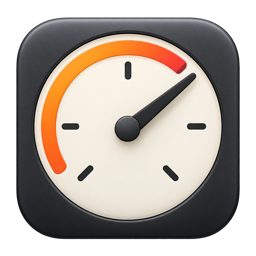
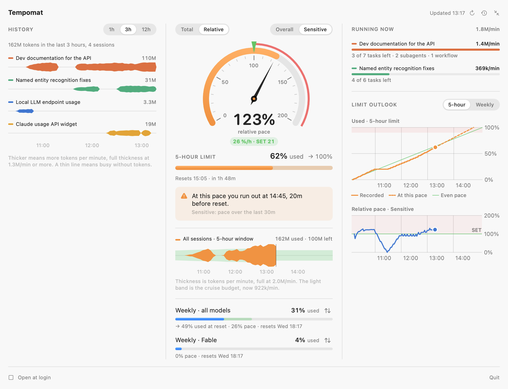
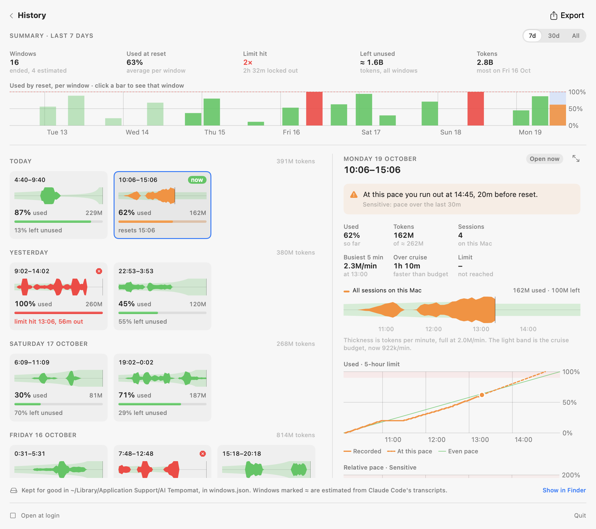
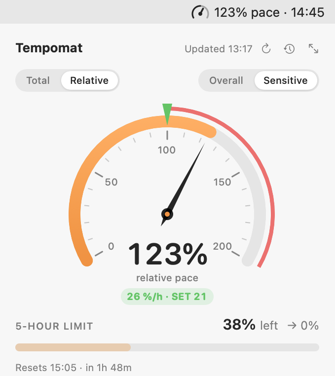
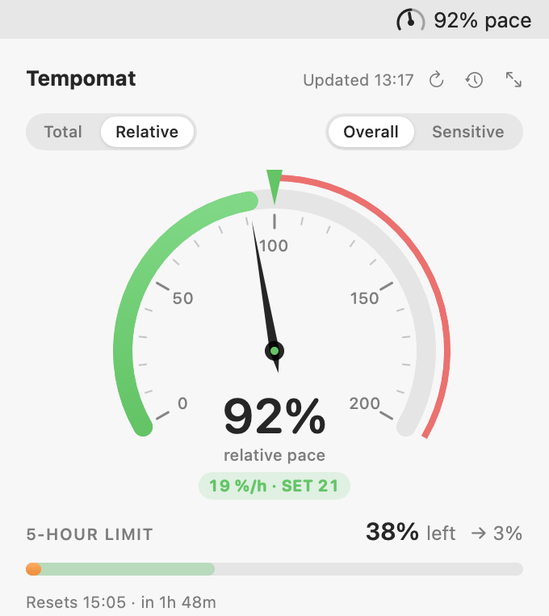
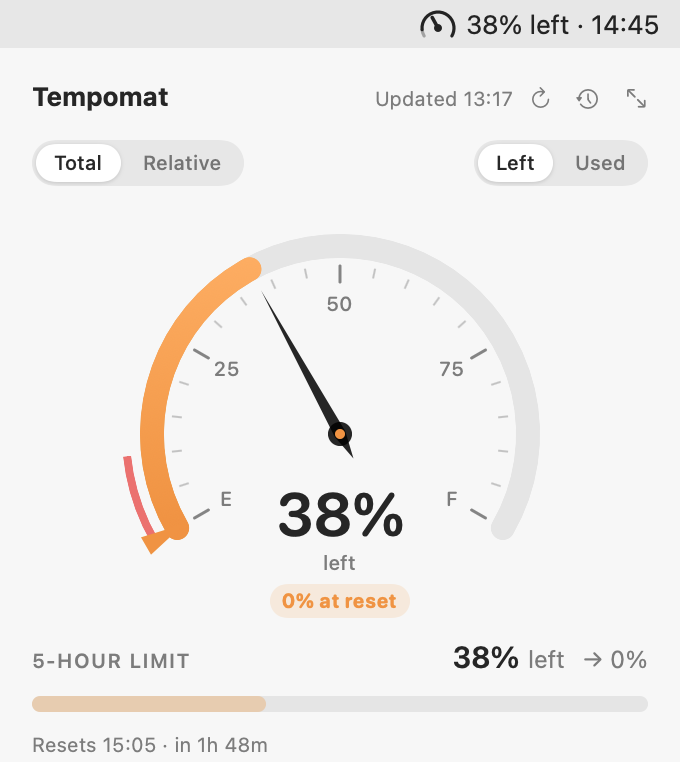
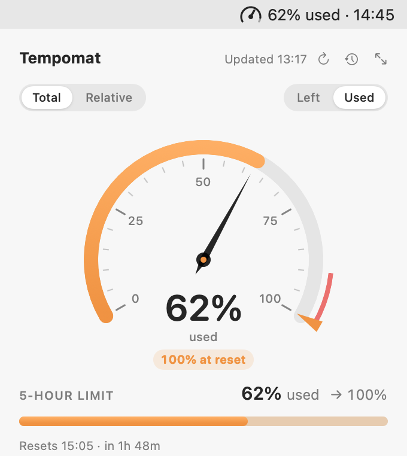

<p align="center">
  
</p>

<h1 align="center">AI Tempomat</h1>

<p align="center">
  <b>Cruise control for your Claude Code limits.</b><br>
  A macOS menu bar gauge that shows how fast your agents burn through your 5-hour and weekly limits,<br>
  and whether that pace gets you to the reset.
</p>

<p align="center">
  
  
  
  
</p>

<p align="center">
  <a href="https://taremeh.github.io/tempomat-ai/"><b>Website</b></a> ·
  <a href="#install">Install</a> ·
  <a href="#updates-and-the-daily-check">Updates</a> ·
  <a href="#reading-the-dial">Reading the dial</a> ·
  <a href="#ethical-considerations">Ethical considerations</a> ·
  <a href="#reference">Reference</a>
</p>

<p align="center">
<picture>
  <source media="(prefers-color-scheme: dark)" srcset="docs/assets/expanded.dark.png">
  
</picture>
</p>

## Why

When you work with agents on a Claude plan, two questions keep coming up:

- **Am I going to hit the limit too early, the way I'm working right now?**
- **Or could I have started a lot more work in this window?**

`/usage` gives you a percentage, and that answers neither. Whether 62% used is too much depends on how long the window still has to run, and with a few agents going at once it's hard to judge.

AI Tempomat answers both with one number: your pace against the pace that would use the rest of the window exactly at reset. Over 100%, you'll hit the limit before the reset, and the menu bar tells you when. Under 100%, budget will be left over, so there's room for more work if you have it. (*Tempomat* is German for cruise control.)

## What you get

- **A gauge in your menu bar.** `92% pace`, `38% left` or `62% used`, plus the time you'd run out when you're going too fast: `123% pace · 17:44`.
- **Four ways to read it.** Relative pace like a speedometer, or Total like a fuel gauge. Averaged over the whole window, or over the last 30 minutes so it reacts to what you're doing now.
- **Which agent burns what.** The expanded view draws every Claude Code session as a ribbon of tokens per minute, lists what's running now with its open tasks and subagents, and charts where the limit is heading.
- **Every window, kept.** The History page keeps each 5-hour window: how much you used, what you left unused at reset, when you hit the limit and how long you waited. Spread one out to find its peaks and what burnt them, down to the subagent and the prompt.
- **Local, and free to run.** Limits come from `claude -p "/usage"`, which never calls the model and costs no quota. Tokens come from Claude Code's transcripts in `~/.claude`. Your usage and tokens stay on your Mac: the only thing the app sends is a [check for updates](#updates-and-the-daily-check) at launch and once a day, with its version numbers, the macOS version, its branch and four yes/no flags, and no ID. You can turn it off.

<p align="center">
<picture>
  <source media="(prefers-color-scheme: dark)" srcset="docs/assets/history.dark.png">
  
</picture>
</p>

## Ethical considerations

**Don't start agents just so the budget isn't "wasted".**

The dial shows when there's room left in the window. That doesn't mean the room has to be filled. Unused budget isn't waste: a window that resets with 20% left used no extra energy at all.

Tokens that get spent do. Every request runs on GPUs in a data center that draw electricity and need cooling, and depending on where and when that power is generated, it adds to carbon emissions and water use. Spent on real work, that can be worth it. Spent to fill a quota, it isn't.

So use the room when there's work waiting that's worth doing, and let the window reset when there isn't. Treat 100% as a ceiling to plan against, not a score to hit.

## Install

Paste this into Terminal:

```bash
curl -fsSL https://raw.githubusercontent.com/Taremeh/tempomat-ai/main/scripts/install.sh | sh
```

Then click the gauge in the menu bar to open the panel, and click **Sign in**. Your browser opens claude.com: approve there, and the panel shows your limits.

You need macOS 14 or later; building it takes Apple's Swift 6 tools, which need macOS 14.5 or later. The script installs Apple's command line tools if they're missing (macOS asks first), clones this repository into `~/tempomat-ai`, builds the app, puts it in `~/Applications` and starts it. If Claude Code isn't installed, the panel offers **Install Claude Code**, which runs Anthropic's installer in a Terminal window. The app needs Claude Code 2.1.29x or later.

Keep the clone: the app's **Update** button pulls and builds there (see [Updating](#updating)), and running the script again does the same. To clone somewhere else, set `TEMPOMAT_DIR`. A folder outside Documents and Desktop spares you a macOS prompt on updates:

```bash
curl -fsSL https://raw.githubusercontent.com/Taremeh/tempomat-ai/main/scripts/install.sh | TEMPOMAT_DIR=~/src/tempomat-ai sh
```

The script never deletes or overwrites a folder of yours: if that folder is already there and isn't a clone of this repository, it stops and says so. Like `./scripts/build-app.sh --install`, it does replace `~/Applications/AI Tempomat.app`. To read it first, see [`scripts/install.sh`](scripts/install.sh).

### Signing in

The app reads usage by running `claude -p "/usage"`. This is a local command, so it never calls the model and costs no quota. It needs Claude Code signed in to your Claude plan, and the desktop app's login isn't shared with the terminal CLI. Until the CLI is signed in, the panel says so and offers **Sign in**.

**Sign in** runs `claude auth login --claudeai` for you, which opens claude.com in your browser. Approve there, and the panel shows your limits a moment later. If the browser didn't open, the panel links to the sign-in page. If the CLI is signed in with a Console account (API billing), the panel offers Sign in too. Signing in replaces that Console login with your Claude plan's login, for `claude` in Terminal as well.

You can also sign in from Terminal instead (if `claude` isn't found there, the panel shows the full path of the copy it uses):

```bash
claude auth login
```

### Install by hand

If you'd rather run each step yourself, install the Xcode command line tools (`xcode-select --install`), then clone, build, install and launch the app:

```bash
git clone https://github.com/Taremeh/tempomat-ai.git
cd tempomat-ai
./scripts/build-app.sh --install
```

Then sign in from the panel, or with `claude auth login`, as above.

In the clone (`~/tempomat-ai` if the script made it), check that the CLI side works without the UI:

```bash
.build/release/AITempomat --print-usage
```

Run the tests:

```bash
./scripts/test.sh
```

### Which account it follows

It follows one account: the one `claude` is signed in to (`claude auth status` names it). Sign `claude` in to another account (`claude auth login`) and the app follows it, though its history doesn't tell the two apart. The sessions it counts are the ones run on that account. A second desktop instance signed in to another account (such as `Claude-Work`, started with `--user-data-dir`) keeps its sessions in `~/.claude` too, and the app leaves those out (see **Which account ran a session** under [How it works](#reference)).

For several accounts side by side, Claude desktop logins and ChatGPT/Codex, build the [`multi-profile`](https://github.com/Taremeh/tempomat-ai/tree/multi-profile) branch instead. Both are the same app (`local.ai-tempomat`), so installing one replaces the other, and they share this account's history and settings.

## Updates and the daily check

Once a day, and at launch, the app asks the AI Tempomat server whether a new version is out. That request is also how the author counts how many people use the app.

**What it sends.** The app's version and build, the macOS version, the git branch you built it from if it's `main` or `multi-profile` (any other branch goes out empty), and four yes/no flags: whether this is its first check today, this week, this month, and ever. A check looks like this:

```
GET /v1/check?v=0.2&b=2&os=26.6&branch=main&day=1&week=0&month=0&first=0
User-Agent: AITempomat/0.2
```

That's all. There's no ID of any kind, no cookie, and nothing about your usage, sessions, account or files.

**How it counts without an ID.** Each install remembers when its last check got through. It sets the day flag on its first check of a new day (in UTC), the week flag on its first check of a new week, the month flag on its first check of a new month, and the first flag only once, ever. The server adds them up: the day flags of a day are the installs that ran that day, the week flags the installs that ran that week, and so on, and the first flags are new installs. A check that doesn't get through is tried again an hour later, so the day isn't lost. If the answer is lost after the server got the check, though, the retry counts again: without an ID, exactly once isn't possible, so the numbers are close rather than exact.

**What the server keeps.** Daily totals per app version and macOS version: how many checks came in, and how many of each flag. No IP addresses, no user agents, and no row per request. The branch only picks which release to compare with, and isn't kept. Cloudflare's database does keep a 7-day history of its changes for recovery (30 days on a paid plan), so for that long the minute a total went up could be read back; after that, only the daily totals are left. Cloudflare handles the request, so it sees your IP address like any web server does, but the server's code doesn't store it. The code is in [`server/`](server).

**Turning it off.** Uncheck **Check for updates** at the bottom of the panel, or run:

```bash
defaults write local.ai-tempomat checkForUpdates -bool false
```

The app reads it before every check, so this works while it runs. Off means the app sends nothing at all, and it won't tell you about new versions either. It never checks in `--demo` mode or the command-line modes such as `--print-usage`, and a build without a server address (`checkURL` in `version.json`) never checks at all and shows no checkbox.

### Updating

When a new version is out, the panel says so. **Update** pulls the folder you built the app from (`git pull --ff-only`) and runs `./scripts/build-app.sh --install`, which builds the new version, replaces the app and restarts it. That takes about a minute. If that folder is in Documents or Desktop, macOS asks whether AI Tempomat may open it, the first time and again after updates, since each build is signed anew.

This works for a clone of this repository on `main` or `multi-profile`. If the folder is on another branch now, or the pull doesn't bring the new version (a fork, say), the update stops and says so instead of building the same version again. An app built from a branch of your own still checks, but doesn't offer releases.

If the update fails (changes of your own in that folder, no network, a remote that asks for a password), the app keeps running and the panel shows the line that says why, with the command to run yourself. The same goes for a folder that has moved. Run it in the folder you built the app from:

```bash
git pull && ./scripts/build-app.sh --install
```

Each update writes its output to `~/Library/Logs/AI Tempomat/update.log`, and **Show log** opens it. Apps built before the update check came in don't have the button, so update those once by hand.

### For maintainers and forks

[`version.json`](version.json) is the release. `version` and `build` are the version numbers (`build` only goes up), `notes` is the line the panel shows for the new version, `url` is an optional page about what's new, and `checkURL` is the server's address. `build-app.sh` builds `version`, `build` and `checkURL` into the app.

To release, raise `build` and `version`, write the notes, and push to `main`. The server reads `version.json` from GitHub, so the push is the release. Apps built from `multi-profile` compare with that branch's `version.json`. With `checkURL` empty, the app never checks. To run your own server, see [`server/README.md`](server/README.md).

To see what a check gets back, without counting as an active user (every flag is `0`; only the day's check total goes up), run:

```bash
"$HOME/Applications/AI Tempomat.app/Contents/MacOS/AITempomat" --check-for-updates
```

It takes another server's URL after the flag too. The first release with a `checkURL` counts every existing install as new once, since none has checked before.

## Reading the dial

The switch at the top of the panel picks how the big dial reads.

<table>
  <tr>
    <td align="center" width="25%"><picture>
  <source media="(prefers-color-scheme: dark)" srcset="docs/assets/dial-1.dark.png">
  
</picture><br><sub><b>Relative · Sensitive</b><br>123%: you'd run out at 2:47</sub></td>
    <td align="center" width="25%"><picture>
  <source media="(prefers-color-scheme: dark)" srcset="docs/assets/dial-2.dark.png">
  
</picture><br><sub><b>Relative · Overall</b><br>92%: about 3% left at reset</sub></td>
    <td align="center" width="25%"><picture>
  <source media="(prefers-color-scheme: dark)" srcset="docs/assets/dial-3.dark.png">
  
</picture><br><sub><b>Total · Left</b><br>38% in the tank</sub></td>
    <td align="center" width="25%"><picture>
  <source media="(prefers-color-scheme: dark)" srcset="docs/assets/dial-4.dark.png">
  
</picture><br><sub><b>Total · Used</b><br>62% burned so far</sub></td>
  </tr>
</table>

**Total** works like a fuel gauge, from 0 to 100% of the limit:
- **Left:** what's still in the tank, from E to F. The red stripe is the last 10%.
- **Used:** what you've burned so far. The red stripe is the last 10% before the limit.
- **Rim marker:** where your current pace leaves you at reset.

**Relative** works like a speedometer. It shows your burn rate compared with the pace that would run out exactly at reset:
- **100% (the green SET marker):** you run out just as the limit resets. Above 100% is the red zone, where you run out first.
- **The pill under the reading:** the raw numbers, for example `26 %/h · SET 21`.
- **Overall:** the pace averaged over everything since the last reset.
- **Sensitive:** the pace over the last 30 minutes (12 hours for weekly limits), so it reacts to what you're doing now.

The other numbers in the panel follow the same switches. Bars and rows show left or used, and the "run out at …" warnings use Overall or Sensitive pace. Your choices are saved.

**All sessions · 5-hour window** (under the dial) is one ribbon across the fixed 5-hour window, like a session's ribbon in the history:
- **Solid ribbon:** its thickness is the tokens all sessions on this Mac burnt per minute, in 5-minute slices, up to now (the vertical mark).
- **Light band behind it:** the cruise budget, the tokens per minute you can burn to use exactly the rest by reset. It starts at a fifth of the limit per hour. It narrows after you burn faster than that and widens after quiet stretches. From now to reset it shows today's budget, the projection.
- **Reading it:** where the ribbon sticks out of the band, you burnt faster than cruise.
- **Scale:** both share one plain scale (twice as thick is twice the rate). Rare spikes are capped at full thickness.
- **Hover:** shows the burn and the budget at that moment. Hover the title for how the tokens were estimated.

`/usage` reports percentages only, so the app estimates the tokens: it compares the tokens every Claude Code session on this Mac used since the window opened with the percentage used. For example, 1.4B tokens at 68% means about 2.1B per window. It needs 5% of the window used for that, and keeps the last good value for the start of the next window. Usage elsewhere (claude.ai, other machines) gets spread over this Mac's tokens. Token counts include everything each request processed, cache reads included.

The big dial shows the limit Claude Code picks: usually the 5-hour one, and a weekly one when that gets critical. To show another, click ⇅ on its row below the dial; the two swap and the menu bar follows. Your pick holds until Claude Code picks a different limit. To follow Claude Code's pick again, swap its limit back onto the dial.

The menu bar shows `38% left`, `62% used` or `123% pace`. When the pace runs out before the reset, it adds the time, for example `62% used · 17:44`.

## Reference

<details>
<summary><b>Expanded view</b></summary>

The icon at the top right of the panel switches between the reduced view (the tempomat alone) and the expanded view, which shows the past, the present and what lies ahead side by side. Your choice is remembered. The panel opens centered under the menu bar reading, so the tempomat sits right below it in either view (near a screen edge, the panel stops at the edge).

- **History (left):** every session as a ribbon along the time axis (1, 3 or 12 hours).
  - Its length is time. Its thickness is the tokens it burnt per minute, on one scale for all sessions, so you can see which session burnt how much and whether it's burning more or less than before. A thin line means the session was busy without using tokens.
  - The scale is compressed so small sessions stay visible next to big ones: a ribbon twice as thick burnt about four times as many tokens. Rare spikes are capped at full thickness. The number beside each name is its total for the time range.
  - Hover a session for its full trajectory, in a card beside it:
    - **Numbers:** tasks, subagents, workflows, tokens, context and the current burn rate.
    - **Token curve:** its tokens over the time range.
    - **Busy strip:** when it was busy, with dots for finished tasks.
    - **Subagents:** each as its own bar on the same time axis, solid while running (the latest 8 when there are more).
    - **Footer:** what it's working on.
- **Tempomat (middle):** the same as the reduced view.
- **Running now (right, top):** the sessions working right now, by how many tokens per minute they burnt over the last 10 minutes, with the work they still have open: tasks left, subagents and workflows running. Hover one for the same trajectory card.
- **Limit outlook (right, bottom):** where the limit is heading, for the 5-hour limit or the weekly one.
  - The top chart shows what was left (or used) at each reading, a dashed line to where the current pace leads, and the even pace that reaches the limit exactly at reset. Being above or below that line shows whether you're ahead or behind.
  - The bottom chart shows the relative pace as it read at each moment. 100% (SET) runs out exactly at reset, and the shaded area above it is the red zone.
  - Both follow the Left/Used and Overall/Sensitive switches. Hover either chart to read its values at that time.
  - The charts start when the app started recording, so a window that opened earlier shows a gap at the start.

</details>

<details>
<summary><b>History page</b></summary>

The clock icon at the top right opens the History page: every 5-hour window, past and current, and how much of each you used. It is a page of its own, not the History column of the expanded view. The arrow at the top left goes back to the tempomat, and the panel always opens on the tempomat.

- **Summary:** for the last 7 days, the last 30 days or everything kept:
  - **Windows:** how many ended, and how many of those are estimated (see below).
  - **Used (or left) at reset:** the average per window. It follows the Left/Used switch.
  - **Limit hit:** how many windows reached 100% before they reset, and how long you then waited.
  - **Left unused:** what the windows still had when they reset, in tokens.
  - **Tokens:** what this Mac's Claude Code sessions used in them, and the busiest day.
  - **Bars:** each window as a bar across its five hours, as tall as the share it used. Red bars hit the limit and faded bars are estimates. Hover for a window's numbers, and click to open it.
- **Tiles:** one per window, a row per day, newest day first. Each shows its hours, its ribbon (as under the dial, on one scale for all tiles), how much it used and how it ended. The current window is marked **now**.
- **Breakdown (right):** the window you click, in full:
  - What happened: used by reset, or the hit and how long before reset, or the pace now for the current window.
  - **Numbers:** used, tokens against the limit, sessions, the busiest 5 minutes, how long the burn ran above the cruise budget, and when the limit was hit.
  - **Ribbon:** all sessions against the cruise budget, as under the dial.
  - **Charts:** the readings and the relative pace, as in the limit outlook. Only windows the app recorded have them.
  - **Sessions:** each session's ribbon and its share of the window's tokens, sessions that have ended included.
- **Expanded window:** the arrows icon at the top right of the breakdown spreads the window across the page, in place of the tiles. The arrows beside it step to the window before or after, and the bars in the summary still pick any window. The icon again goes back to the tiles. Your choice is remembered.
  - **Timeline:** all sessions against the cruise budget, then each session, on one wide time axis. Hover any lane for a line through all of them and the burn at that moment.
  - **Prompts:** a small ▾ marks every prompt you gave, in the session's color: all of them on the all-sessions ribbon, and each session's on its own. Hover a mark to read the prompt. Commands you ran (`/compact`) count, and what Claude Code adds by itself (task notifications) doesn't.
  - **Main agent and subagents:** in each session's ribbon, the solid core is its main agent and the light edge is its subagents, in proportion to their tokens.
  - **Peaks:** up to four stretches where the burn peaked, numbered on the timeline. A peak grows around one of the busiest 5 minutes while the minutes beside it burnt at least half as much, an hour at most. An even burn has none.
  - **What burnt the tokens:** a card per peak, with its tokens, how fast that was against the cruise budget, and its share of the window. For each session that burnt in it: its main agent, each workflow (with its agents and their tokens) and each subagent on its own, the prompt it was working on (from before the window if need be), and its tasks in progress. Hover a card or a number to find the peak on the timeline.
- **Export:** saves the history to your Downloads folder and shows it in Finder. JSON holds everything: each window's readings, tokens per 5 minutes and sessions (with their prompts, tasks and subagents), and the readings of the windows still open. CSV has one row per window.

**Recorded or estimated.** When a window resets, the app keeps its readings and reads the tokens used in it from the transcripts. For times the app wasn't running (or the Mac slept through a reset), it estimates the windows from Claude Code's transcripts: a window opens with the first request after the previous one reset, as the plan's do. Estimated windows are marked ≈. Their share used is their tokens at the tokens per 1% that recorded windows measured, so usage on claude.ai or other machines isn't in it. The first launch reads every transcript (about 20 seconds for 3 GB), and later passes only those written since.

**What each session did.** With each window, the app keeps what every session did in it: your prompts (the first 200 characters of each), when its tasks were in progress, and each subagent's tokens per 5 minutes, with the workflow it ran in. Windows kept before the app did this get it filled in once from the transcripts still on disk; a window whose transcripts are gone keeps its tokens, and its sessions are drawn without prompts or subagents.

</details>

<details>
<summary><b>How it works</b></summary>

- **Data:** the `usage_report.rate_limits.limits[]` rows from `/usage` (stream-json output). The report is marked experimental, so its shape may change. Supported since Claude Code 2.1.29x.
- **CLI:** the app uses the newest `claude` binary it can find, including the copy bundled with the Claude desktop app.
- **Sign in:** runs `claude auth login --claudeai` with that binary, without Terminal. The CLI opens claude.com in your browser and finishes by itself once you approve. The app doesn't log or keep what the CLI prints: it only picks out the sign-in link, for when the browser didn't open. **Cancel** stops the sign-in, and it gives up after 10 minutes.
- **Install Claude Code:** writes a short script to `~/Library/Caches/AI Tempomat/install-claude-code.command` and opens it in Terminal. That script downloads Anthropic's installer from `https://claude.ai/install.sh` and runs it, which puts `claude` in `~/.local/bin`, and says whether that worked. The app looks for it every 5 seconds for up to 10 minutes (**Cancel** stops looking), and then offers Sign in.
- **Polling:** every 2 minutes, plus a refresh whenever you open the panel.
- **Where the data is kept:** in `~/Library/Application Support/AI Tempomat/`. macOS doesn't clear this folder, and Time Machine backs it up.
  - `history.json` holds the readings of the windows still open.
  - `windows.json` keeps every window that has ended, for good: its readings, its tokens per 5 minutes, and each session's share, prompts, tasks and subagents. Windows the app recorded replace estimates of the same time.
  - Both are written whole to a new file and then swapped in, so a crash can't leave half a file. A file that can't be read is moved aside as `….unreadable-<time>.json` rather than overwritten. When two copies of the app run, each adds what the other saved.
  - The tokens come from Claude Code's transcripts in `~/.claude/projects`, of the sessions run on the account. Claude Code deletes transcripts after `cleanupPeriodDays` (30 days unless you set it in `~/.claude/settings.json`), but the windows keep their own copy of the counts.
- **Pace:**
  - Overall = used ÷ time since the window opened. The 5-hour window is 5 hours and weekly windows are 7 days.
  - Sensitive = the slope over the last 30 minutes (12 hours for weekly limits).
  - Each falls back to the other when it has no data. Sensitive needs about 15 minutes of samples first (6 hours for weekly limits).
  - Usage only moves in 1% steps, so Sensitive is jumpy at low usage.
- **Relative pace:** pace ÷ ((100 − used) ÷ hours to reset) × 100.
- **Projection:** time to run out = (100 − used) ÷ pace, compared with the reset time.

**Sessions (expanded view):**
- **Sessions:** the registry files in `~/.claude/sessions/<pid>.json` (name, folder, start time, busy or idle). A file only counts while its process is still running Claude Code.
- **Which account ran a session:** `~/.claude.json` names the account `claude` is signed in to (no credentials are read). Each desktop instance files its record of a session it runs under the account it runs on, `claude-code-sessions/<account>/<organization>/` in its data folder (`~/Library/Application Support/Claude`, `Claude-Work`, …). A session the desktop app ran on another account doesn't count, and neither do its tokens; terminal sessions always count. Windows saved before the app did this lose such sessions at launch. While the account can't be read, every session counts.
- **Transcripts:** `~/.claude/projects/<folder>/<session>.jsonl`, and the subagent transcripts beside it in `<session>/subagents/`. The app reads only the lines added since the last scan.
- **Tokens:** each request's input, cache writes, cache reads and output, counted once per request (the transcript repeats a request's usage on every content block).
- **Tasks:** the TaskCreate and TaskUpdate calls, or the TodoWrite list in sessions that use that.
- **Running subagents:** those whose transcript changed in the last 45 seconds. Finished workflows leave a file in `<session>/workflows/`.
- **Polling:** one scan at launch, then every 5 seconds while the panel is open. The first scan reads every transcript in full, which takes a few seconds with long sessions.

</details>

<details>
<summary><b>Options</b></summary>

```bash
defaults write local.ai-tempomat claudePath /path/to/claude
```

```bash
defaults write local.ai-tempomat refreshInterval -float 60
```

The interval is in seconds, with a minimum of 30.

```bash
defaults write local.ai-tempomat checkForUpdates -bool false
```

Turns off the daily update check, like the **Check for updates** checkbox in the panel, also while the app runs. It's on unless you set this (see [Updates and the daily check](#updates-and-the-daily-check)).

```bash
defaults write local.ai-tempomat updateCheckURL https://example.com/v1/check
```

Sends the update check to another server instead of the `checkURL` the app was built with, for testing or a fork. Quit and reopen the app after setting it. Its checks are counted apart from the built-in server's, so testing doesn't use up the app's first check of the day.

</details>

<details>
<summary><b>Development</b></summary>

```bash
swift run AITempomat --demo
```

```bash
swift run AITempomat --render-preview preview.png
```

```bash
swift run AITempomat --print-fleet
```

```bash
swift run AITempomat --render-expanded expanded.png
```

```bash
swift run AITempomat --print-history
```

```bash
swift run AITempomat --render-history history.png
```

```bash
swift run AITempomat --export-history ~/Desktop
```

`--demo` runs with fake data. `--open-panel` opens the panel right after launch. `--render-preview` writes the reduced panel in all four modes to a PNG, and the expanded panel to an `.expanded.png` beside it, each with a `.dark.png` copy. `--print-fleet` prints the Claude Code sessions running now, as the expanded view reads them. `--render-expanded` renders the expanded panel from live data: your plan usage and its recorded history, and the running sessions. `--render-preview` also writes the History page with fake data to a `.history.png`, and its newest window expanded, in full, to a `.history.window.png`. `--print-history` lists the past 5-hour windows with their prompts and subagents, `--render-history` renders the History page from your data (and its newest window expanded to a `.window.png`), and `--export-history` writes the JSON and CSV export into a folder. These read the saved files and change nothing.

</details>
